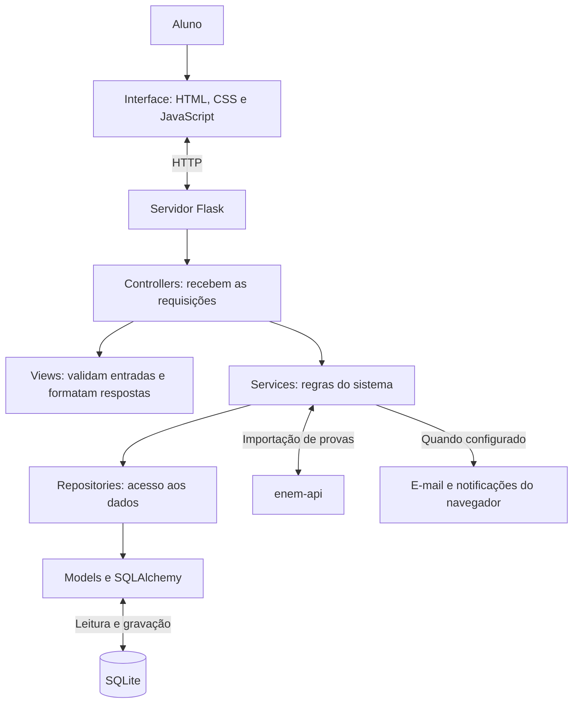
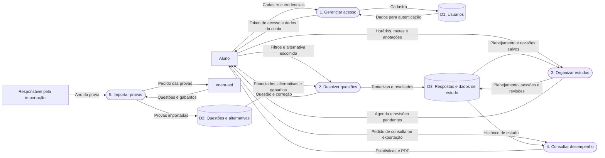

# Arquitetura e fluxo de dados

O sistema tem três partes principais: as páginas que o aluno usa no navegador, o servidor que processa as ações e o banco que guarda os dados. Na execução local, o Flask entrega tanto as páginas quanto a API.

## Diagrama de arquitetura

Os nomes das camadas correspondem às pastas do backend. A pasta `views` contém validações e formatos de resposta da API; as telas ficam em `frontend/public`.

A consulta à enem-api acontece na importação das provas. Depois disso, as questões são consultadas no banco local.

## Diagrama de fluxo de dados (DFD simplificado)

Este diagrama mostra os principais dados que entram e saem do sistema. Os processos e depósitos foram agrupados para facilitar a leitura; não representam todas as rotas ou tabelas.

Por exemplo, ao responder uma questão, o aluno envia a alternativa escolhida. O servidor consulta o gabarito, registra a tentativa e devolve o resultado. Esse histórico também é usado nas estatísticas e nas revisões.
