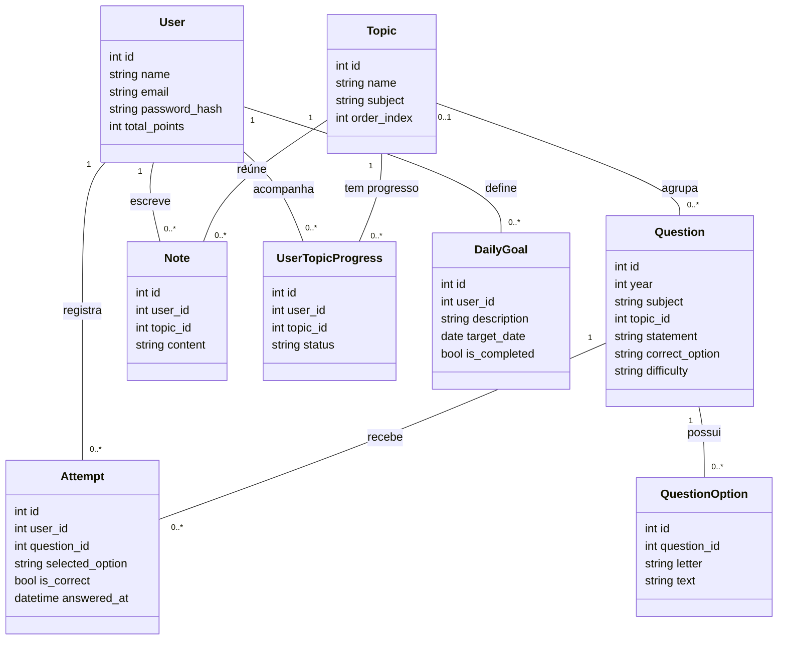

# Diagrama de classes do domínio

Este diagrama mostra as principais classes usadas no cadastro, na resolução de questões e na organização dos conteúdos. Para facilitar a leitura, apresenta apenas os atributos mais importantes. Os nomes são os mesmos das classes e dos atributos em `backend/models`.

## Diagrama simplificado

## Como ler

- `1` significa exatamente um; `0..1`, nenhum ou um; `0..*`, nenhum ou vários.
- `User` representa o aluno. Ele pode registrar várias respostas (`Attempt`), escrever anotações (`Note`) e definir metas (`DailyGoal`).
- `Question` representa uma questão, e `QuestionOption`, uma alternativa. Cada resposta liga um aluno a uma questão.
- `Topic` representa um tópico de estudo. Uma questão pode estar ligada a um tópico ou ainda não ter essa ligação.
- `UserTopicProgress` guarda o andamento de um aluno em um tópico. Existe no máximo um registro para cada combinação de aluno e tópico.
- `id` identifica um registro. Atributos como `user_id`, `topic_id` e `question_id` fazem a ligação entre os registros.

Os campos `subject` de `Topic` e `Question` guardam a matéria como texto. Eles não representam uma ligação com a classe `Subject`, usada no calendário.

As classes de calendário, Pomodoro, revisão, notificações e outras funções auxiliares ficaram fora deste resumo. Os dados dessas funções estão descritos no [dicionário de dados](dicionario-dados.md).
