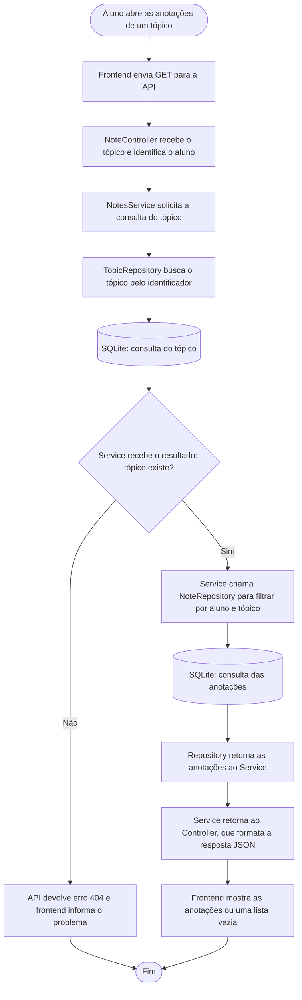
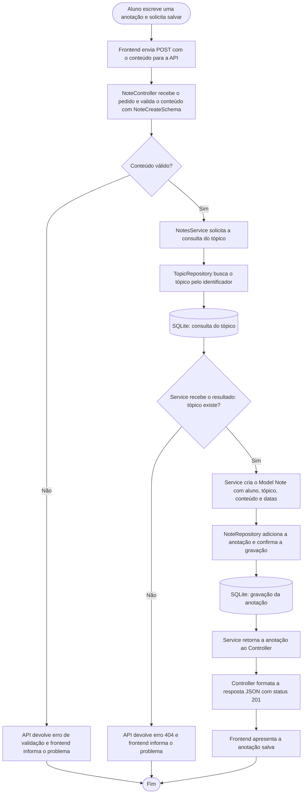

# Fluxogramas dos casos de uso

Estes fluxogramas mostram como o sistema consulta e salva anotações de um tópico, ações do caso de uso UC05. O aluno precisa estar conectado à sua conta.

As etapas seguem o código do projeto: o Controller recebe o pedido, o Service organiza a operação e aplica as regras, e o Repository acessa o banco usando os Models e o SQLAlchemy.

## Recuperação de dados — Consultar anotações

A consulta usa `GET /api/topics/{topic_id}/notes`. O método `NoteRepository.list_for_topic` busca somente as anotações daquele aluno e tópico, ordenadas da atualização mais recente para a mais antiga.

## Entrada de dados — Criar uma anotação

A criação usa `POST /api/topics/{topic_id}/notes`. O conteúdo deve ser um texto com pelo menos um caractere. Os métodos `add` e `commit`, usados por `NoteRepository`, são herdados de `BaseRepository`.

Os diagramas mostram o caminho principal e as verificações de conteúdo e tópico. As verificações de autenticação acontecem antes de executar as ações do Controller.
